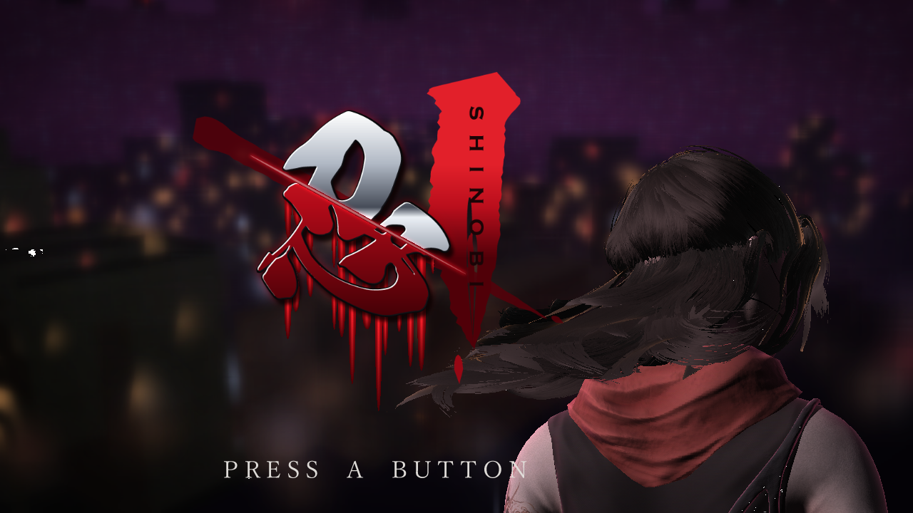

# タイトルシーンの実装(カメラ・UI・後ろ姿のプレイヤー・夜の街)

2026-11-20 の作業。タイトルシーンを「カメラ・UI・プレイヤー・背景」に分けて作り直し、ロゴを斬る演出の後ろに、強い風に髪がなびく後ろ姿のプレイヤーと、ぼけた夜の街(ステージ1)を置いた。



*ゲームで撮った画像(斬り終わった後)。*

---

## 0. 要点

- **シーンは「合図を出すだけ」**。斬る・揺らす・ボタンを出すなどの中身は、カメラ・UI・プレイヤーがそれぞれ持つ。
- **ロゴは 3D の 1 点に置いてカメラで写す**。だからカメラの揺れ(既存の `StartCameraShake`)や寄り引きが、そのままロゴに効く。
- **プレイヤーは 2 つのモデルを重ねている**。体はゲームのモデル、髪は IdaFaber のモデル(Unity と同じ描き方)。
- **髪・布・息は骨をコードで動かしている**。アニメはポーズで止めたまま。
- **背景はステージ1を別の画面に描いてぼかしている**。遠くからは明かりが光って見えないので、光の玉を足している。

### ファイルの一覧

| 役割 | ファイル |
|---|---|
| シーン | [Scene/TitleScene.cpp](../2026_winter/Scene/TitleScene.cpp) / [.h](../2026_winter/Scene/TitleScene.h) |
| カメラ | [Camera/CameraState/TitleCamera.cpp](../2026_winter/Camera/CameraState/TitleCamera.cpp) / [.h](../2026_winter/Camera/CameraState/TitleCamera.h) |
| ロゴ | [UI/TitleLogoUI.cpp](../2026_winter/UI/TitleLogoUI.cpp) / [.h](../2026_winter/UI/TitleLogoUI.h) |
| 白い光 | [UI/TitleFlashUI.cpp](../2026_winter/UI/TitleFlashUI.cpp) |
| PRESS A BUTTON | [UI/TitlePressUI.cpp](../2026_winter/UI/TitlePressUI.cpp) |
| 周辺減光 | [UI/TitleBackUI.cpp](../2026_winter/UI/TitleBackUI.cpp) |
| プレイヤー | [Character/Player/TitlePlayer.cpp](../2026_winter/Character/Player/TitlePlayer.cpp) / [.h](../2026_winter/Character/Player/TitlePlayer.h) |
| 背景の街 | [Stage/TitleCity.cpp](../2026_winter/Stage/TitleCity.cpp) / [.h](../2026_winter/Stage/TitleCity.h) |
| Unity と同じ描き方(もらったもの) | [Render/Mv1LikeUnity.h](../2026_winter/Render/Mv1LikeUnity.h) |

---

## 1. 全体の流れ

### 毎フレームの更新([TitleScene::Update](../2026_winter/Scene/TitleScene.cpp))

```
m_frame++                 シーンが始まってからのフレーム
UpdateDirection()         決まったフレームで合図を出す
フェード / 入力           A で飛ばす・次のシーンへ
m_cameraManager->Update() カメラ(揺れもここ)
m_player->Update()        髪・布・息
m_uiManager->Update()     ロゴ・白い光・ボタン
```

### 描く順([TitleScene::NormalDraw](../2026_winter/Scene/TitleScene.cpp))

```
m_city->Draw()          ① 背景の街(別の画面に描いてぼかして貼る)
m_uiManager->DrawBack() ② 周辺減光(TitleBackUI。UILayer::Back)
m_player->Draw()        ③ プレイヤー(3D)
m_uiManager->Draw()     ④ ロゴ・閃光のエフェクト・白い光・PRESS A BUTTON
```

奥から手前の順。フェード中は最後に黒い四角を重ねる。

---

## 2. シーン: 合図を出すだけ

[TitleScene.cpp](../2026_winter/Scene/TitleScene.cpp) の `UpdateDirection` が、決まったフレームで各部品に合図を出す。中身(何フレームかけて何をするか)は各部品が知っている。

| フレーム | 合図 | 何が起きるか |
|---|---|---|
| 0〜45 | (カメラが自分で) | 少し寄った所から引いて、ロゴが縮みながら出てくる |
| 85 `kSlashFrame` | `m_logo->Slash()` | 斬り口の光が走り、閃光のエフェクトが出る |
| 89 `kImpactFrame` | `StartCameraShake(9, 20)` / `m_flash->Start()` / `m_player->OnImpact()` | 画面が揺れて白く光る。突風で髪があおられ、光が赤くなる |
| 140 `kPressFrame` | `m_press->Show()` | PRESS A BUTTON が明滅し始める |

- 演出の途中で A を押すと `SkipDirection` で、カメラ・ロゴ・ボタン・プレイヤーを「斬り終わった所」まで飛ばす。
- それ以降の A でフェードアウトして、ステージセレクトへ進む。

---

## 3. カメラ: `TitleCamera`

[TitleCamera.cpp](../2026_winter/Camera/CameraState/TitleCamera.cpp) は既存のカメラの仕組み(`CameraStateBase`)の1つとして作った。シーンで `CameraManager` を作り、`InitState(TitleCamera)` で始める(プレイヤー・ステージは無し)。

### 1単位 = 1ピクセル

カメラを z=0 の面からちょうど「1単位が画面の1ピクセル(1280×720 のとき)になる距離」に置いている。

```cpp
const float kDistance = Game::kScreenHeight * 0.5f / std::tan(kFov * 0.5f);
```

こうすると、ロゴの位置や大きさを今までどおりピクセルで考えられる。

### 画角は 22°(望遠)

最初は 60° だったが、プレイヤーを大きく写すと顔や体がゆがむので、望遠にした。ロゴは「z=0 の面で1単位=1ピクセル」なので、画角を変えても大きさは変わらない。

### 揺れは既存の `StartCameraShake` をそのまま使う

既存の揺れは**カメラの位置だけ**を動かす。注視点がロゴの近くにあると、カメラが動いてもロゴは画面の真ん中に残り、揺れて見えない。そこで**注視点をずっと奥(z=100000)に置いた**。カメラの位置が動くと、見る向きはほぼ変わらずに平行に動くので、ロゴが画面の中で揺れて見える。

### 出始めの寄り

最初の 45 フレームで、1.06 倍寄った所から引く(ease out)。前はロゴの画像を拡大してやっていたのを、カメラの動きにした。

### `CameraManager` 側の変更

タイトルカメラを登録しただけ(揺れの仕組みには触っていない)。

- [CameraStateBase.h](../2026_winter/Camera/CameraState/CameraStateBase.h): `Type::TitleCamera = 26`
- [CameraManager.h](../2026_winter/Camera/CameraManager.h) / [.cpp](../2026_winter/Camera/CameraManager.cpp): `CameraStateName::TitleCamera`、デバッグ表示の名前、`ChangeStateFromScene` の分岐

---

## 4. UI

[UIManager::TitleInit](../2026_winter/UI/UIManager.cpp) で周辺減光(`TitleBackUI`)を登録し、シーンが合図を出す UI(ロゴ・白い光・ボタン)はシーンで作って `Add` し、最後に `InitAll` を呼ぶ。

### ロゴ `TitleLogoUI`([.cpp](../2026_winter/UI/TitleLogoUI.cpp))

前のタイトルシーンにあった「斬る・赤く染まる・垂れる」のシェーダーの処理を、そのまま UI に移した。変えたのは**位置と大きさの決め方**。

```cpp
//3D の (−110, 40, 0) を今のカメラで画面に写す
const VECTOR center = ConvWorldPosToScreenPos(VGet(kWorldX, kWorldY, 0.0f));
const VECTOR up     = ConvWorldPosToScreenPos(VGet(kWorldX, kWorldY + 1.0f, 0.0f));
//1単位が画面で何ピクセルか → ロゴ画像の大きさに掛ける
scale = (center.y - up.y) * kHeight / m_height;
```

- 3D の点を写すので、カメラの揺れ・寄り引きがロゴに効く。
- `Slash()` からの経過フレームはロゴが自分で数える(斬り口の光 → 上がずれる → 赤く染まる → 垂れる)。
- 斬った瞬間の閃光(Effekseer 2D)の更新・描画もロゴが持つ。
- プレイヤーを右に置いたので、ロゴは少し左(x=−110)にした。

### 白い光 `TitleFlashUI` / ボタン `TitlePressUI` / 周辺減光 `TitleBackUI`

- [TitleFlashUI](../2026_winter/UI/TitleFlashUI.cpp): `Start()` から 10 フレーム、画面に白を加算して消える。
- [TitlePressUI](../2026_winter/UI/TitlePressUI.cpp): `Show()` からゆっくり明滅。ロゴの下(x=530)。
- [TitleBackUI](../2026_winter/UI/TitleBackUI.cpp): 周辺減光の画像を乗算するだけ(背景の塗りつぶしは街に置き換えたのでやめた)。

---

## 5. プレイヤー: `TitlePlayer`

[TitlePlayer.cpp](../2026_winter/Character/Player/TitlePlayer.cpp)。画面の右に、後ろ向きで強い風に髪がなびいている姿。

### 5.1 体と髪で 2 つのモデルを重ねる

| | 体 `m_body` | 髪 `m_hair` |
|---|---|---|
| モデル | ゲームのプレイヤー(`PlayerModel` を複製) | IdaFaber の SK_VEX_01(`data/Title/IdaFaber/`) |
| 見せるメッシュ | 髪以外(髪は `MV1SetMeshVisible` で隠す) | 髪だけ |
| 描き方 | `CharacterLook`(本編と同じ) | `Mv1LikeUnity::Draw`(Unity と同じ) |
| 光 | `CharacterLook::Settings()` を描く間だけ差し替え | DxLib の標準ライトを描く間だけ差し替え |

**なぜ重ねるのか**: ゲームのモデルの髪は、後ろから寄るとまばら(地肌が見える)だった。IdaFaber の描き方は髪がきれいだが、体の見え方は前のほうが良かった。なので髪だけ IdaFaber にした。

- 2 つのモデルは、どちらも**頭の骨を同じ位置**(`kHeadPos`)に置く。
- 頭の大きさが少し違うので、「`spine_05` から `head` までの長さ」で髪のモデルの大きさを体に合わせる。
- 髪のメッシュの名前は、どちらもマテリアル名が `MAT_HAIR` で始まるので、それで見分ける(`SetHairVisible`)。

### 5.2 ポーズで止める

```cpp
//アニメCSVの TitlePose = Ninja_Idle_LookingAround の 116.8077 フレームで止める(再生速度 0)
m_body.anim.Init(m_body.handle, GetAnimName("TitlePose"), false, 0.0f, -1.0f, kPoseFrame);
```

- アニメは Player と同じく `Animation m_anim` と、アニメCSVから作った `m_animNames`(キー → アニメ名)で持つ。
- IdaFaber のモデルには、モーションが別ファイル(`Ninja_Idle_LookingAround.mv1`)で入っていて、骨の数も違う(166本)。なので `SetAnimSourceModel(handle, true)` で**骨の名前で**当てる(→ 7 章)。

### 5.3 骨をコードで動かす(`RotateFrame`)

毎フレーム、①骨をアニメの姿勢に戻し(`MV1ResetFrameUserLocalMatrix`)、②「骨の位置を中心に、ワールドの向きで回す」回転を、親から順に足す。

```cpp
//骨のワールド行列 = ローカル行列 × 親のワールド行列
world = local * parentWorld;
//骨の位置を中心に回す: 原点へ戻す → 回す → 元の位置へ
world = world * Translate(-pivot) * worldRot * Translate(pivot);
//ローカルに戻して設定する
MV1SetFrameUserLocalMatrix(handle, frame, world * Inverse(parentWorld));
```

回転をワールドの向きで考えられるので、骨ごとの軸の向き(モデルによって違う)を気にしなくてよい。

### 5.4 風(`UpdateWind`)

対象は髪(前 6段×左右、後ろ 7段×左・真ん中・右、ポニーテール 3段)と、首まわりの布(`cng_cloth_*`。強さ 0.6)。根元の骨から順に次をする。

1. **風下へ曲げる**: 今の骨の向き(子の骨へ向かう向き)と風の向きの間の角度の **38%** だけ、風の方へ回す。根元から順に回すので、先の骨ほど風の向きにそろい、横に流れる形になる。
2. **ばたつき**: 2 つの sin を足した揺れを重ねる。先の骨ほど大きく、根元から少し遅れて伝わる。房ごとに位相をずらす。
3. **突風**: 風の強さを 2 つのゆっくりした波で強弱させる。斬った瞬間(`OnImpact`)に強い突風を足して、だんだん減らす。

風の向きは「画面の右から左・少し上・少し手前」(`kWindDir`)。回す向きは「回した後に風に近づく方」を選んでいるので、回転の向きの決まりに頼らない。

### 5.5 息(`UpdateBreath`)

270 フレーム周期で背骨(`spine_03` / `spine_05`)を前後にわずかに傾け、吸うときに肩(`clavicle`)を少し上げる。

### 5.6 体と髪に同じ動きをさせる

骨の番号はモデルごとに違うので、モデルごとに `PoseModel`(ハンドル・アニメ・骨の番号の一覧)を持ち、同じ `m_frame` の式で動かす。乱数を使っていないので、2 つのモデルはぴったり同じ動きになる。

---

## 6. 背景: `TitleCity`

[TitleCity.cpp](../2026_winter/Stage/TitleCity.cpp)。ステージ1の街を高い所から見下ろした絵を、ぼかして一番奥に貼る。

### 6.1 読み込み

- 本編の `Stage` クラスは使わない(当たり判定の登録や、ステージ1の敵の読み込みまで走るため)。
- `CyberStage.mv1`(見た目)を直接読み、当たり判定のモデルで床の高さを調べて、`Stage::GameInit` と同じ位置にずらす(明かりの CSV もこの位置が前提)。
- 空(`SkyBox`)、明かり(`StageLights`、5番)、夜のもやも本編と同じ部品を使う。

### 6.2 描き方

```
① 画面の 1/2 の大きさの別の画面(MakeScreen)に切り替える
② 背景用のカメラ(ステージの座標で左手前の高い所から広場を見下ろす・画角45°)に変える
③ 空 → もや付きで街 → 光の玉 を描く
④ 明るい所だけ 1/4 の画面に取り出して(BRIGHT_CLIP)、大きくぼかす → にじみ
⑤ 街の画面全体もぼかす(GAUSS)
⑥ 元の画面に戻し、タイトルのカメラ・ライトを元に戻す
⑦ 街を画面いっぱいに貼り、にじみを加算で重ねる
```

`SetDrawScreen` を呼ぶとカメラの設定が戻ってしまうので、描く前にカメラ(位置・注視点・画角・ニア/ファー)とライトを覚えておいて、⑥で戻している。

### 6.3 光の玉を足した理由

ステージ1の明かりは「周りの壁や床を照らす」もので、明かり自体は光らない。しかも通りの低い所にあるので、上から見るとビルに隠れる。結果、遠くから見ると街がほぼ真っ暗だった。そこで光の玉を置いた。

- **明かりの位置**: 明かりの CSV(`data/Stage/Lights/Stage005.csv`)の位置・色・届く距離で、ぼんやり光る玉を置く。
- **窓の明かり**: モデルの面のうち**横を向いた面(壁)**だけを集め、面積に比例してランダムに 2500 点を選ぶ。壁から少し浮かせた所に、暖色(多め)・赤・青白の玉を置く。
- どちらも**深さは見るが書かない**加算のビルボード。ビルの陰になる玉は隠れる。ゆっくり瞬く。
- 描いた後は、ステージの明かりに空のリストを渡して、タイトルのプレイヤーに明かりが残らないようにする。

---

## 7. 本編と共通のコードに入れた変更

タイトルのために、本編でも使うコードを少し変えた。どれも既定の動きは今までどおり。

| ファイル | 変更 | 本編への影響 |
|---|---|---|
| [Character/Animation.h](../2026_winter/Character/Animation.h) / [.cpp](../2026_winter/Character/Animation.cpp) | `SetAnimSourceModel(handle, isNameCheck = false)`。true なら別のモデルのアニメを**骨の名前で**当てる | 既定は今までどおり番号で当てる(ボスの腕はそのまま) |
| [Render/CharacterLook.cpp](../2026_winter/Render/CharacterLook.cpp) | `MV1GetMeshVisible` が FALSE のメッシュは描かない | 隠したメッシュはもともと描かれない前提なので、変わらないはず(本編では未確認) |
| [DataLoader/DataManager.h](../2026_winter/DataLoader/DataManager.h) / [.cpp](../2026_winter/DataLoader/DataManager.cpp) | `LoadPlayerAnimData()` を public にして中身を書いた | 起動時にプレイヤーのアニメCSVを読む(本編で `LoadAll` がもう一度読んでも上書きされるだけ) |
| [Main/Application.cpp](../2026_winter/Main/Application.cpp) | 起動時に `LoadPlayerAnimData()` と、Mv1LikeUnity のシェーダーの準備(`ShaderDir()` → `InitLoadShaders()`) | 起動が少し重くなる |
| [data/Player_CSV/Player01Anim.csv](../2026_winter/data/Player_CSV/Player01Anim.csv) | `TitlePose,Ninja_Idle_LookingAround` を足した | なし |
| カメラ(3 章) | `TitleCamera` を登録 | なし |

---

## 8. データ

- `data/Title/IdaFaber/`(約 66MB)
  - `SK_VEX_01/`: モデル・`SK_VEX_01_Materials.txt`・画像。**4096 の画像は 2048 に縮めた**(元は 184MB。本編のプレイヤーの画像を縮めたのと同じ扱い)
  - `shaders/bin/`: Mv1LikeUnity のシェーダー
  - `Ninja_Idle_LookingAround.mv1`: ポーズのモーション
- 元は `Downloads/LooksLikeUnity_IdaFaber_Dxlib/Runtime/`。`Mv1LikeUnity.h` はそのまま `Render/` に写した(関数は全部 inline なので、複数の .cpp から読んでよい)。

---

## 9. 試してやめたこと

| 試したこと | どうなったか |
|---|---|
| 顔のアップ(斜めの顔)+ 目線・首をカメラへ回す | 後ろ姿に変えたので消した。目の骨を「置いた時の顔の前」を基準に回す方法は使えた |
| ゲームのモデルの髪を両面で描く | 地肌のまだらはかなり減った。IdaFaber に切り替えたので今は使っていない |
| 髪の切り抜きのしきい値を下げる(0.31 → 0.08) | 半透明が白く浮いて悪化 |
| 髪を減らす前のモデル(git の 7312d9d の Player03) | まだらは残った。ファイルは消した |
| ステージ1をそのまま遠くから写す | ほぼ真っ暗(6.3)。光の玉を足して解決 |

---

## 10. まだ残っていること

- A で演出を飛ばす・ステージセレクトへ進むところを、ゲームで試していない。
- 背景の左端に細い黒い線が少し見える(背景用カメラの近くの何か)。
- 背景の街は、カメラの揺れでは動かない。
- ステージ1と IdaFaber のモデルを読む分、タイトルが出るまでの時間が延びているはずだが、測っていない。
- `CharacterLook` の変更で本編の見た目が変わっていないかは、本編の画面で見ていない。
