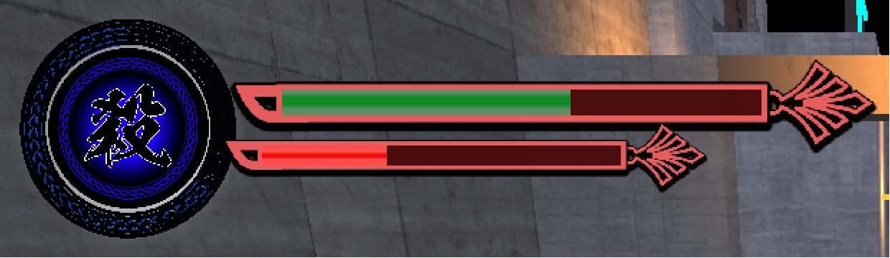
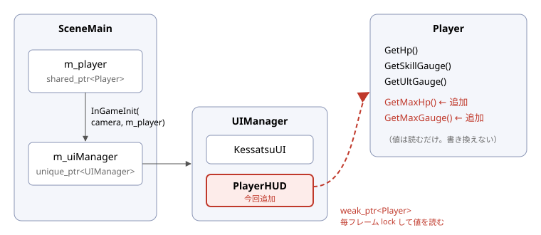
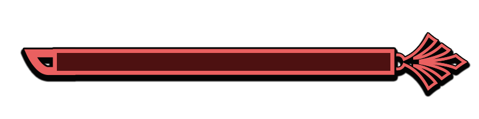
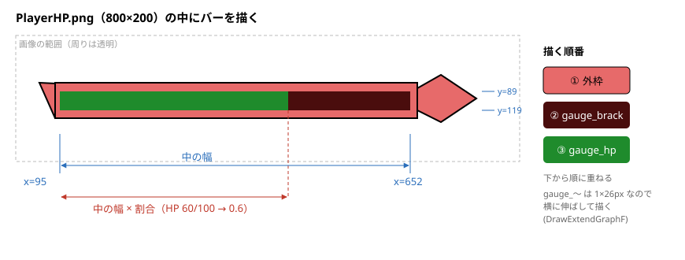
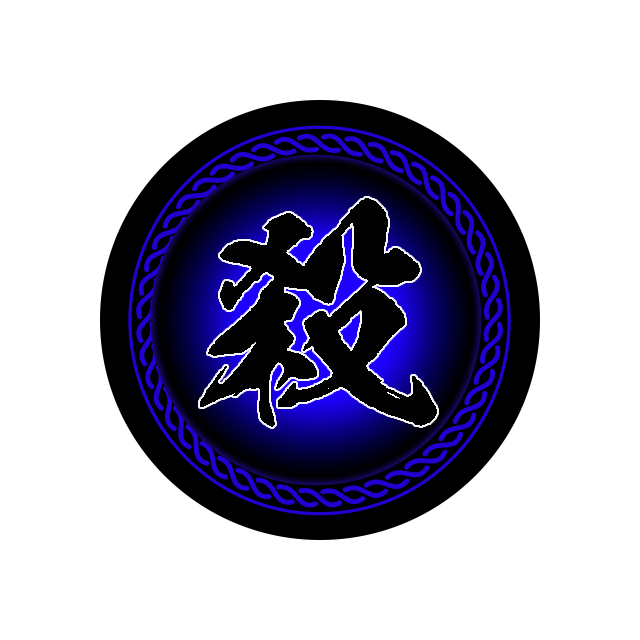
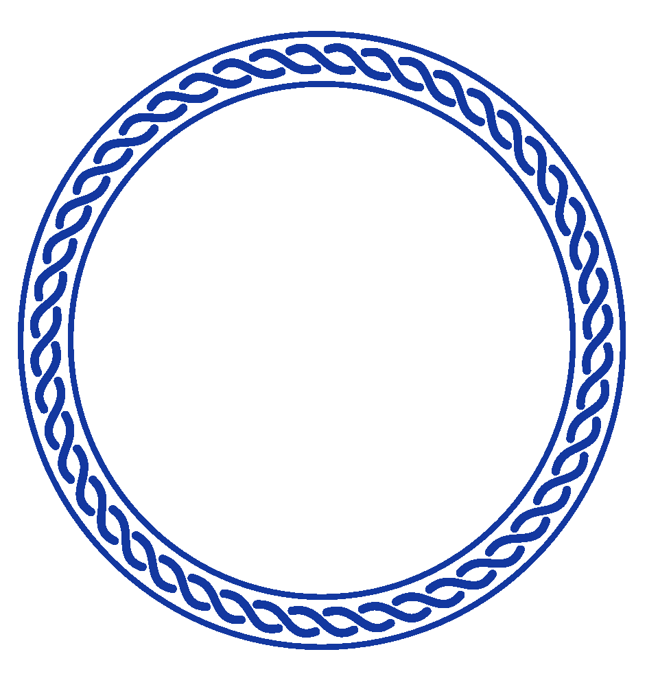
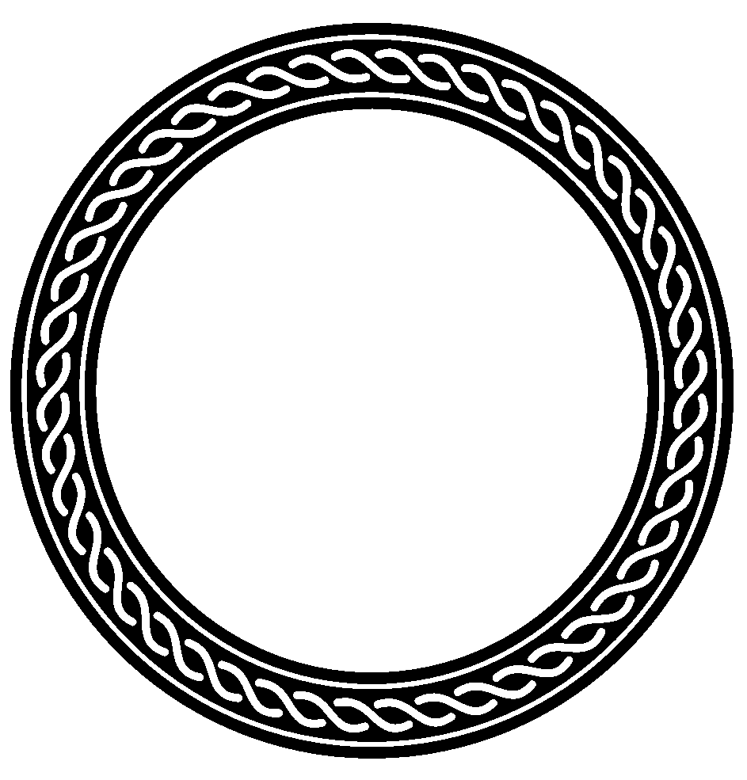
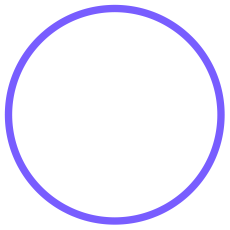
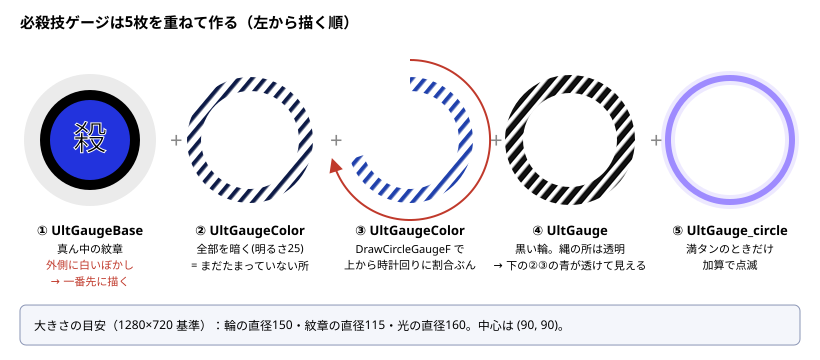

# プレイヤーのHUD(HP・スキル・必殺技ゲージ)

2026-11-04 の作業。`data/UI/HUD/` の素材で、画面左上にプレイヤーのゲージを出した。



*ゲームで撮った画像(確認用に HP60・スキル35・必殺技65 にしたもの)。必殺技ゲージは上から時計回りに青い縄が光り、左上の暗い所がまだたまっていない分。*

---

## 0. その前に: UIフォルダの整理に合わせた読み込み先の変更

`data/UI/` をフォルダ分けしたので、血殺UIの画像のパスを変えた。

| ファイル | 前 | 今 |
|---|---|---|
| `UI/KessatsuUI.cpp` | `data/UI/blood_UI.png` など | `data/UI/bloodUI/blood_UI.png` など(3つ) |

---

## 1. 全体の作り



- **`PlayerHUD`**(`UI/PlayerHUD.h/.cpp`、新規)は `UIBase` を継承した1つのクラス。HP・スキル・必殺技の3つをまとめて描く。
- **`UIManager::InGameInit`** の引数にプレイヤーを足し、その中で `KessatsuUI` と同じく `Add` で登録する。
- プレイヤーは **`weak_ptr`** で持つ。UIがプレイヤーの寿命を延ばさないようにするため。毎フレーム `lock()` して、取れなければ表示しない。
- HUDは**値を読むだけ**。ゲージを増やす・減らすのはこれまで通りプレイヤー側の仕事。

### 変更したファイル

| ファイル | 新規/変更 | 中身 |
|---|---|---|
| `UI/PlayerHUD.h/.cpp` | 新規 | HUD本体 |
| `UI/UIManager.h/.cpp` | 変更 | `InGameInit(camera, player)`、`PlayerHUD` を登録 |
| `Scene/SceneMain.cpp` | 変更 | `InGameInit(m_cameraManager, m_player)` |
| `Character/Player/Player.h/.cpp` | 変更 | `GetMaxHp()` / `GetMaxGauge()` を追加 |
| `2026_winter.vcxproj` / `.filters` | 変更 | PlayerHUD を登録 |

### 最大値の取得を足した理由

HUDは「今の値 ÷ 最大値」で割合を出す。最大値をHUD側に `100` と書いてしまうと、プレイヤーの最大HPを変えたときにHUDだけずれる。
そこで、最大値はプレイヤーから受け取るようにした。

```cpp
int GetMaxGauge()const { return kMaxGaugeValue; }//スキル・必殺技ゲージの最大値
int GetMaxHp()const;//最大HP(中身は kInitialHp を返す。kInitialHp は Player.cpp の無名namespaceにあるので .cpp に書いた)
```

---

## 2. HP・スキルのバー

使う素材:

| 外枠 | HP | スキル | 減った所 |
|---|---|---|---|
|  | `gauge_hp.png` (1×26) 緑 | `gauge_Skill.png` (1×26) 赤 | `gauge_brack.png` (1×26) |



- `gauge_〜` は**横1ピクセル**の画像なので、`DrawExtendGraphF` で好きな幅に伸ばせる。幅を「中の幅 × 割合」にすればゲージになる。
- 中の範囲(x95〜652、y89〜119)は、PlayerHP.png の暗い赤の部分をピクセルで調べた値。
- 外枠は同じ画像を2回使う。HPは倍率0.6、スキルは0.45 で下に描く。

### なめらかに減らす

本当の値を直接描くと、ダメージで一瞬で減る。そこで**表示用の割合**(`m_dispHpRate` など)を別に持ち、毎フレーム本当の値に近づけている。

```
表示 += (本当の値 − 表示) × 0.15     ← kFollowRate
```

```
HP  100 ─┐
         │  ダメージ
本当  60 ─┴──────────────────────
表示  100 ╲
           ╲__
              ╲___
                  ╲______ 60      ← 毎フレーム残りの15%ずつ近づく(最初は速く、だんだんゆっくり)
```

※「遅れて減る赤いゲージ」(白や赤の残像が少し待ってから減る)にしたいときは、表示用の値をもう1本足して、ダメージから数十フレーム待ってから近づければよい。

---

## 3. 必殺技ゲージ(丸)

使う素材:

| ① 紋章 | ②③ 色 | ④ 輪 | ⑤ 満タンの光 |
|---|---|---|---|
|  |  |  |  |



- **輪(UltGauge)の縄の部分は透明**になっている。その下に青い縄(UltGaugeColor)を置くと、黒い輪の縄だけが青く光って見える。
- まだたまっていない所も縄が見えるように、②で青い縄を**全部、暗く**描いてから、③で**たまった分だけ明るく**描く。
- ③は DxLib の `DrawCircleGaugeF`(画像を円グラフのように切って描く関数)。

```cpp
//そのままだと反時計回りなので左右反転する
DrawCircleGaugeF(cx, cy, 割合 * 100.0, m_ultColorHandle, 0.0, 倍率, TRUE);
```

- 満タンのときは⑤を加算で描き、`sin` で明るさを変えて点滅させる。

---

## 4. つまずいた所(3つ)

### ① 黒い輪が灰色に見えた → 乗算済みアルファで読む

```
 ふつうのアルファ                         乗算済みアルファ
 縮小で「黒(不透明)」と「白(透明)」を      色に先に透明度を掛けておくので
 混ぜると…                                透明な所の色は (0,0,0) になる
   色 = (黒 + 白) / 2 = 灰色  ✕              色 = (黒 + 0) … 黒のまま  ○
```

- 素材は大きい(943×985)のを 0.16倍まで縮めて描くので、隣のピクセルが混ざる。
- PNG の透明な所の色が**白**(255,255,255)だったので、黒い縄と透明な白が混ざって灰色になっていた。
- `SetUsePremulAlphaConvertLoad(TRUE)` で読み込み、`DX_BLENDMODE_PMA_ALPHA` で描くと直る(満タンの光は `DX_BLENDMODE_PMA_ADD`)。

### ② それでも輪が白っぽい → 紋章の白いぼかしが上にかぶっていた

- `UltGaugeBase.png` には、紋章の外側に**ほぼ透明な白いぼかし**が広がっている(画像の端まで)。
- 最初は紋章を最後(一番上)に描いていたので、ぼかしが輪の上にかぶっていた。
- 紋章を**一番先**に描くようにした。ぼかしは輪の下に隠れ、輪の外にだけ少し光として残る。
- 輪の内側の細い透明な線から、ぼかしの白が細い円として見えている。気になるなら紋章を少し小さくするか、素材のぼかしを消す。

### ③ 反時計回りにたまっていた

- `DrawCircleGaugeF` は、そのままだと**上から反時計回り**に描かれた(撮った画像で確認)。
- 左右反転(ReverseX = TRUE)で時計回りにした。輪は左右対称なので見た目は変わらない。

---

## 5. 調整する値(`PlayerHUD.cpp` の先頭)

座標は**1280×720 を基準**にした値で、`Game::ScaleX/ScaleY/GetScale` で実際の画面の大きさに合わせている。

| 定数 | 今の値 | 意味 |
|---|---|---|
| `kHpX / kHpY / kHpScale` | 140, 10, 0.6 | HPの外枠の左上と倍率 |
| `kSkillX / kSkillY / kSkillScale` | 140, 62, 0.45 | スキルの外枠 |
| `kUltX / kUltY` | 90, 90 | 必殺技ゲージの中心 |
| `kUltRingScale` | 150/910 | 輪の直径150 |
| `kUltBaseScale` | 115/453 | 紋章の直径115 |
| `kUltMaxScale` | 160/436 | 満タンの光の直径160 |
| `kUltEmptyBright` | 25 | たまっていない所の明るさ(0〜255) |
| `kFollowRate` | 0.15 | 表示が本当の値に近づく速さ |
| `kBlinkSpeed` | 0.1 | 満タンの点滅の速さ |
| `kInnerLeft〜Bottom` | 95, 652, 89, 119 | PlayerHP.png の中のバーの範囲(画像のピクセル) |

---

## 6. 確認したこと・まだのこと

- Debug・Release(x64)ともビルドは通った。
- `-bench -stage=3`(ステージ1)で起動して画面を撮った。満タンのときと、一時的に初期値を変えたとき(HP60・スキル35・必殺技65)。初期値は元に戻してある。
- **まだ**: 実際に戦ってゲージが減る・たまるときの動き(なめらかさ・満タンの点滅)。必殺技中・処刑の演出中・リザルト中に隠すかどうか(今はいつも表示)。
- Debug ビルドは F2 の ImGui が最初から出ていて、HUDの上に重なる(F2 で消せる)。
