# メニューUI(NINJA GAIDEN 4 風のステージセレクト)

2026-11-04 の作業。NINJA GAIDEN 4 のメニュー画面を分析して、同じ作り方のUIをステージセレクトに実装した。

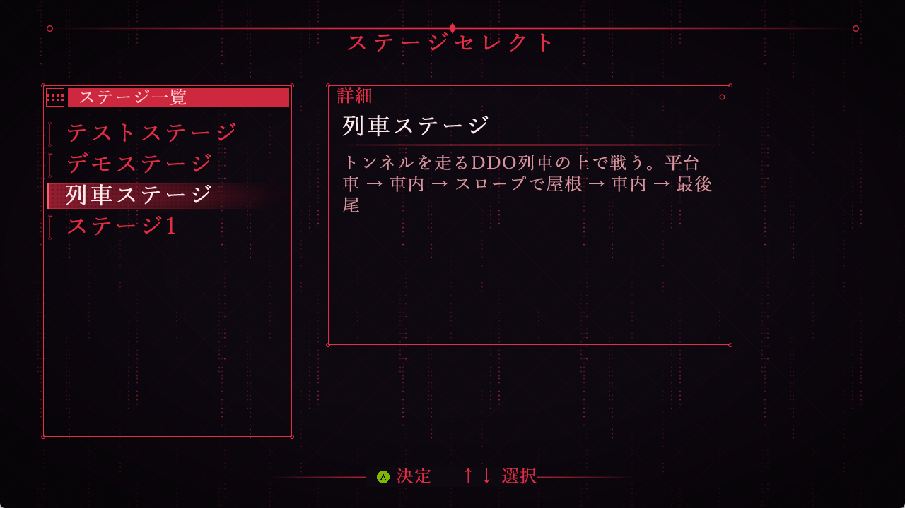

*ゲームで撮った画像。シェーダーは使っていない。素材はスクリプトで作った仮素材。*

---

## 0. 要点

- メニューは「**画面全体の演出**」「**位置が決まった部品**」「**文字**」の3つに分けて考える。
- シェーダーが本当に必要なのは背景の一部だけ。残りはPNGとブレンドモードで作れる。
- 今回はシェーダーを使わず、`MenuUI` クラスと仮素材のPNG 9枚で作った。
- ステージセレクトの文字だけの表示を、このUIに置き換えた。

---

## 1. 分析: どの部分を何で作るか

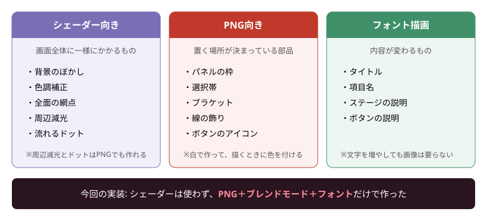

見分け方は単純で、**どこに描くか**と**内容が変わるか**を見る。

| 見るところ | 向いている作り方 |
|---|---|
| 画面全体に同じようにかかる | シェーダー |
| 置く場所が決まっている | PNG |
| 内容が変わる | フォント |

---

## 2. 画面の部品

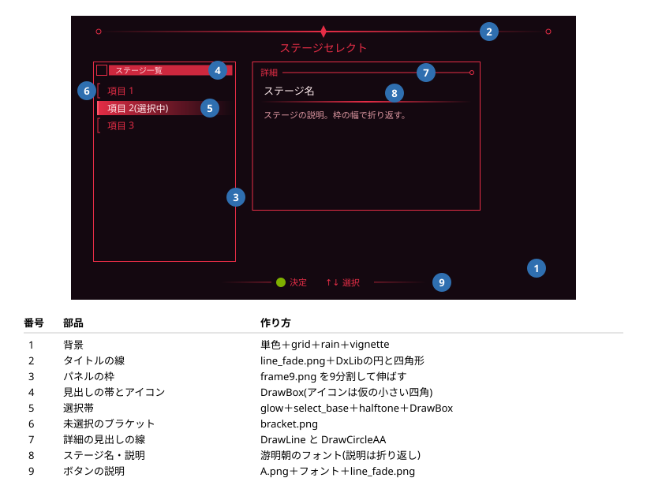

座標は1280×720(設計解像度)で書き、描くときに `Game::ScaleX/Y` で画面の大きさに直す。

---

## 3. 重ねる順番

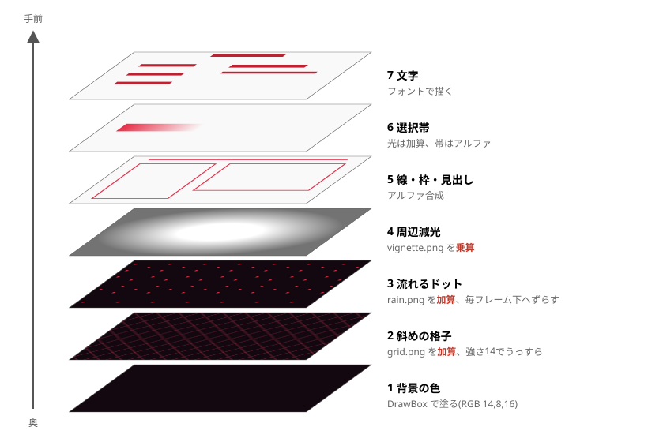

下から順に描くだけで、奥行きのある画面になる。背景の4枚を重ねる処理は `DrawBackground` にまとまっている。

### ブレンドモードの使い分け

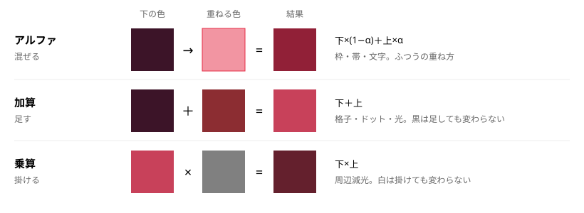

- **光らせたいものは加算**: 黒い部分は変わらないので、黒背景の画像がそのまま使える。
- **暗くしたいものは乗算**: 白い部分は変わらないので、中心を白にすれば端だけ暗くなる。

---

## 4. 素材のPNG

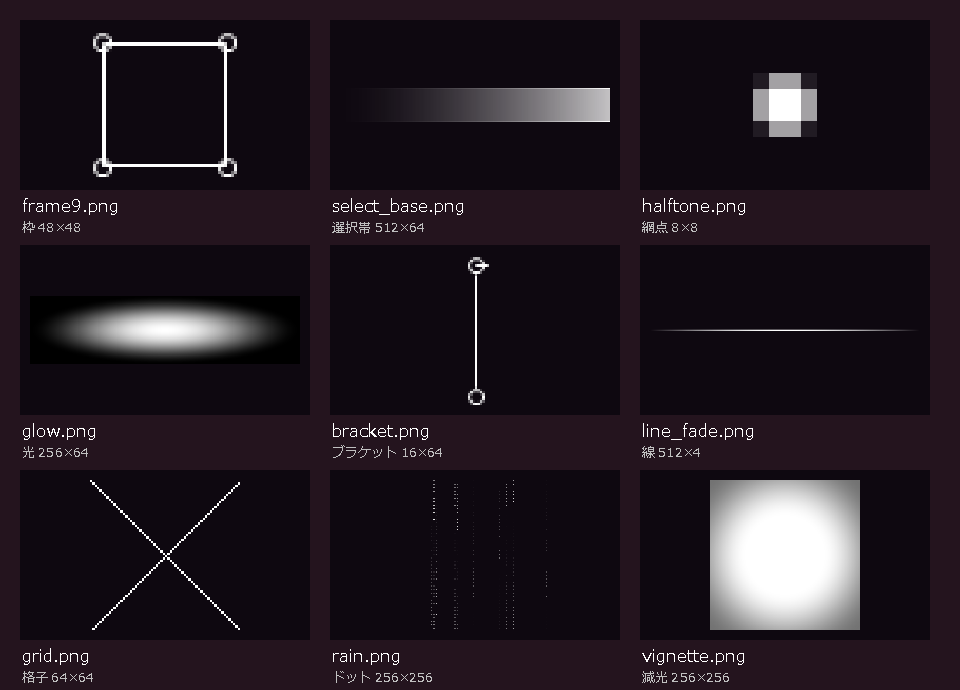

*`data/UI/Menu/` の9枚。暗い背景に置いて撮ったもの。網点は小さいので拡大している。*

- `tools/MenuUIGen/MakeMenuPng.ps1` を実行すると作り直せる。
- 赤い線や帯は、画像の時点では白い。**描くときに `SetDrawBright` で色を付ける**ので、同じ画像を色違いでも使える。
- 本番の絵ができたら、同じファイル名で置き換えればよい。

---

## 5. 枠: 9スライス

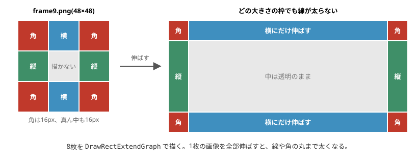

パネルの大きさが変わっても線の太さと角の形が変わらないように、画像を9つに分けて伸ばす。真ん中は透明なので描かない。

---

## 6. 背景: 繰り返しとスクロール

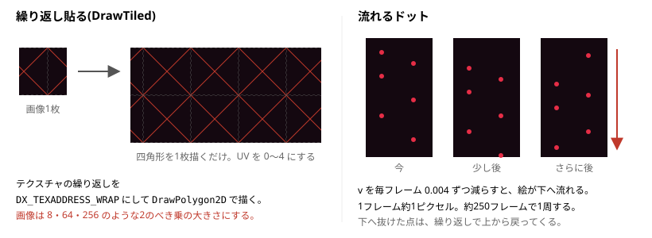

格子とドットは小さい画像を画面全体に繰り返す。画像をたくさん並べるのではなく、**四角形1枚のUVを1より大きくする**。

```cpp
SetTextureAddressMode(DX_TEXADDRESS_WRAP);
DrawPolygon2D(vtx, 2, handle, TRUE);
SetTextureAddressMode(DX_TEXADDRESS_CLAMP);//戻す
```

---

## 7. 選択帯

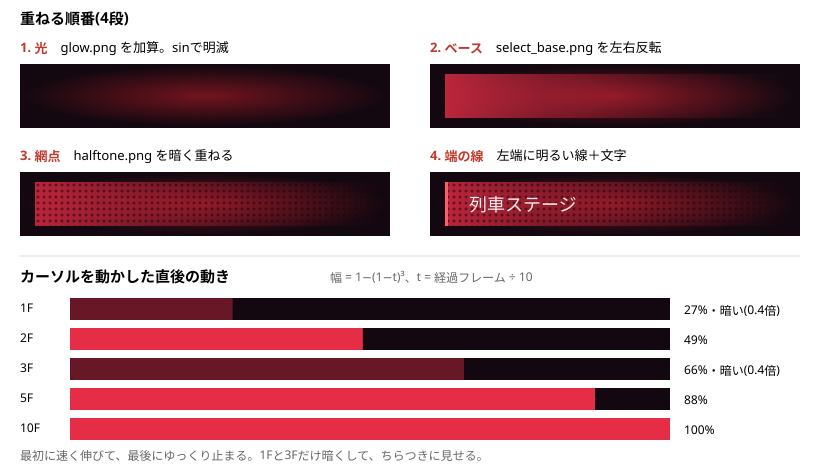

1枚の絵にせず、部品を重ねる。部品ごとに動かせるので、次の動きを少ないコードで作れる。

| 動き | やり方 |
|---|---|
| 帯が伸びる | 幅に `1-(1-t)³` を掛ける |
| 出始めのちらつき | 最初の4フレームのうち、奇数フレームだけ明るさを0.4倍 |
| 光の明滅 | `sin` で加算の強さを変える |

---

## 8. クラスの作りとデータの流れ

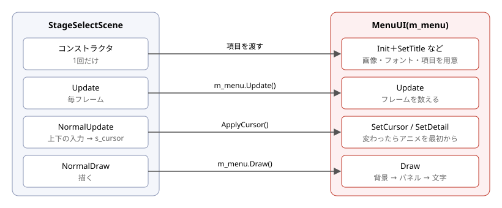

- `MenuUI` は `UIBase` を継承せず、`StageSelectScene` がメンバーとして持つ。
- カーソルの値を持つのはシーン側。`MenuUI` は渡された値を描くだけ。
- `ApplyCursor()` は毎フレーム呼ばれるが、`SetCursor` は値が同じなら何もしないので、アニメは止まらない。

### 変更したファイル

| ファイル | 新規/変更 | 中身 |
|---|---|---|
| `UI/MenuUI.h/.cpp` | 新規 | メニューの描画 |
| `Scene/StageSelectScene.h/.cpp` | 変更 | 文字だけの表示をやめて `m_menu` で描く |
| `tools/MenuUIGen/MakeMenuPng.ps1` | 新規 | 仮素材を作る |
| `data/UI/Menu/*.png` | 新規 | 仮素材 9枚 |
| `2026_winter.vcxproj` / `.filters` | 変更 | MenuUI を登録 |

### 使い方

```cpp
m_menu.Init();
m_menu.SetTitle("ステージセレクト");
m_menu.SetListHeader("ステージ一覧");
m_menu.SetItems(items);
m_menu.SetCursor(s_cursor);
m_menu.SetDetail("詳細", info.name, info.description);
```

---

## 9. つまずいたこと

### グラデーションが2段になった

周辺減光が段々になり、外側が真っ黒に切れていた。

| 直す前 | 直した後 |
|---|---|
| 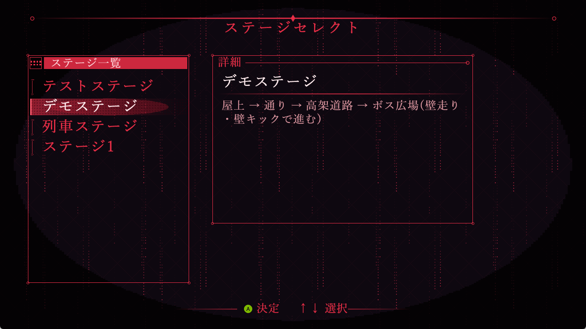 |  |

原因は3つ重なっていた。

**1. PowerShellが小数を丸めていた**

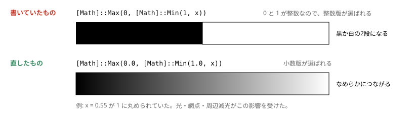

**2. 拡大の補間が最近傍だった**

256pxの画像を画面いっぱいに伸ばすと、画素の四角がそのまま見える。メニューを描く間だけバイリニアにした。

```cpp
SetDrawMode(DX_DRAWMODE_BILINEAR);
//メニューを描く
SetDrawMode(DX_DRAWMODE_NEAREST);//戻す
```

**3. 暗い背景に減光が強すぎた**

背景の色は(14,8,16)ととても暗い。そこに強い減光を掛けると、ほぼ黒になる。アルファで黒を重ねる方式から乗算に変え、暗くする量も減らした。

### 新しいソースはBOM付きUTF-8で保存する

プロジェクトは MultiByte で `/utf-8` なし。BOMが無いと、日本語の文字列が正しく読まれない。文字列は実行時に Shift-JIS になるので、説明文の折り返しも2バイト文字を見て区切っている。

---

## 10. 確認したこと・残り

**確認済み**

- Debug(x64)でビルドが通った。
- ゲームを起動して、表示、カーソル移動、説明文の折り返しを画面で見た。

**未確認**

- Releaseビルド。
- 1280×720以外の解像度。
- コントローラーでの操作(確認はキーボードの入力で行った)。

**残り**

- 仮素材を本番の絵に差し替える。
- 見出しのアイコン(今は小さい四角を並べた仮のもの)を作る。
- ボタンのアイコンの色をメニューに合わせる(今はAボタンが緑のまま)。
- 必要なら、シェーダーで背景のぼかし・走査線・グリッチを足す。
