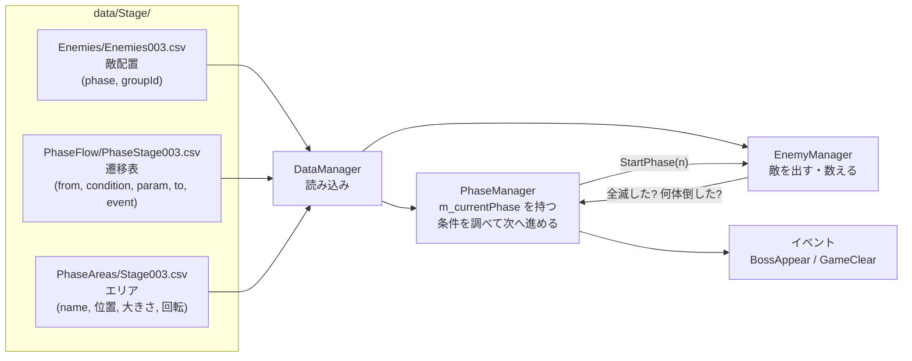
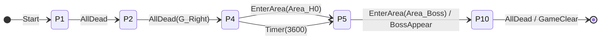
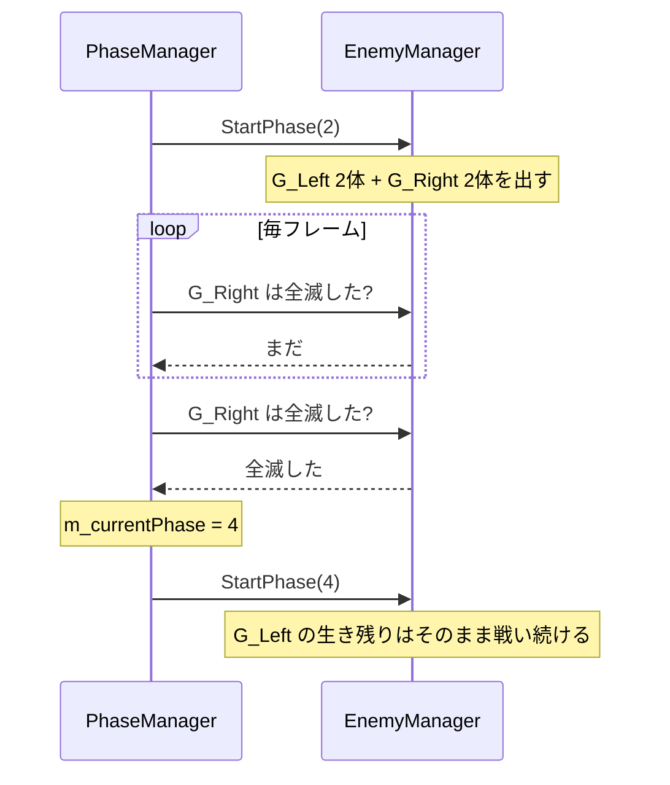
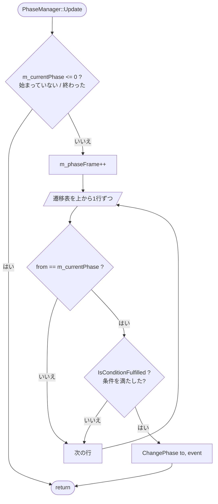
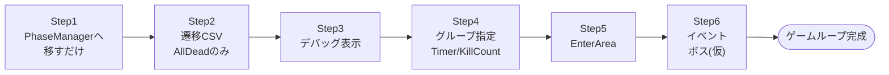

# フェーズ進行の外部化 設計メモ

作成: 2026-10-14
目的: ボス(仮)まで含めたゲームループを作るために、「次のフェーズを出す条件」をCSVに出す。

---

## 1. 全体像



| クラス | 役目 |
|---|---|
| `PhaseManager`(新規) | 今のフェーズ番号を持つ。毎フレーム遷移表を見て、条件を満たしたら次へ進める |
| `EnemyManager` | 「このフェーズの敵を出す」「このグループは全滅したか」に答えるだけ。**次のフェーズを決めない** |
| `DataManager` | CSV 3枚を読む |

---

## 2. 考え方

### フェーズは「番号」、CSVの行は「矢印」

`m_currentPhase` は今までと同じく **int 1つ**。遷移表の1行はフェーズそのものではなく、「どこからどこへ、何をしたら進むか」という矢印。



- 今のフェーズを `from` に持つ行を**上から順に**調べる
- **最初に**条件を満たした行の `to` へ進む(上の P4 は「エリアに入る」か「60秒経つ」の早いほう)

### 「進行の段階」と「敵のまとまり」を分ける

| 言葉 | 意味 | どこに書く |
|---|---|---|
| phase | ゲームの進行の段階。**同時に1つだけ** | 敵配置CSVの `phase` 列 = そのフェーズが始まったら出る |
| group | いっしょに倒される敵の集まり | 敵配置CSVの `groupId` 列 |

**同時に2つのまとまりを出したいとき**は、同じ phase 番号にして groupId で分ける。

```
敵配置CSV                       遷移表
phase=2, groupId=G_Left  ┐
phase=2, groupId=G_Left  ├─ フェーズ2で同時に出る
phase=2, groupId=G_Right │      2,AllDead,G_Right,4,None
phase=2, groupId=G_Right ┘        → G_Right が全滅したら 4 へ
                                    (G_Left は残っていてもよい)
```



- `AllDead` の param が**空**なら「今のフェーズで出た敵が全滅」(今と同じ動き)
- フェーズ4の `AllDead`(param なし)は**フェーズ4で出た敵だけ**を数える(前の生き残りでいつまでも終わらない、を防ぐ)
- 注意: `groupId` は「1体が気づいたら全員気づく」にも使っている。分けたくなったら `killGroup` 列を足す

---

## 3. CSVの形

### 遷移表 `data/Stage/PhaseFlow/PhaseStage003.csv`

```csv
#from,condition,param,to,event
0,Start,,1,None
1,AllDead,,2,None
2,AllDead,G_Right,4,None
4,EnterArea,Area_H0,5,None
4,Timer,3600,5,None
5,EnterArea,Area_Boss,10,BossAppear
10,AllDead,,-1,GameClear
```

| condition | param の意味 | 満たす条件 |
|---|---|---|
| `Start` | なし | すぐ(ゲーム開始用。from=0) |
| `AllDead` | グループ名(空なら今のフェーズの敵全部) | 対象が全員死んだ |
| `KillCount` | 数 | このフェーズに入ってから N 体倒した |
| `Timer` | フレーム数 | このフェーズに入ってから N フレーム経った |
| `EnterArea` | エリア名 | プレイヤーの足元がエリアの箱の中にある |

| event | 内容 |
|---|---|
| `None` | 何もしない |
| `BossAppear` | `BossAppearCamera` を流す |
| `GameClear` | クリア処理(まずはログ → リザルトへ) |

`to = -1` は「終わり」。

### エリア `data/Stage/PhaseAreas/Stage003.csv`

壁ゾーンCSVと同じ形にする(読み込み・Unityエクスポーター・デバッグ描画を流用できる)。

```csv
#name,posX,posY,posZ,halfExtentX,halfExtentY,halfExtentZ,rotYDeg
Area_H0,0,-200,14000,1500,500,300,0
Area_Boss,0,-200,27000,2000,800,400,0
```

---

## 4. 処理の流れ



```cpp
void PhaseManager::Update()
{
    if (m_currentPhase <= 0) return;//始まっていない or 終わった
    m_phaseFrame++;

    for (const auto& t : m_transitions)
    {
        if (t.from != m_currentPhase) continue;
        if (!IsConditionFulfilled(t)) continue;
        ChangePhase(t.to, t.event);
        return;
    }
}

void PhaseManager::ChangePhase(int next, PhaseEvent event)
{
    m_currentPhase = next;
    m_phaseFrame = 0;
    m_killCount = 0;
    if (next > 0) m_enemyManager->StartPhase(next);
    //event の処理(BossAppear / GameClear)
}
```

### 1行分のデータ

```cpp
struct PhaseTransition
{
    int from = 0;
    PhaseConditionType condition = PhaseConditionType::AllDead;
    std::string param;     //読み込み時の文字列(AllDead のグループ名・エラー表示用)
    int intParam = 0;      //Timer / KillCount 用
    int areaIndex = -1;    //EnterArea 用(読み込み時に名前から引いておく)
    int to = -1;           //-1 なら終わり
    PhaseEvent event = PhaseEvent::None;
};
```

### EnterArea の判定

当たり判定(Collider)は使わず、足元の座標を箱のローカル座標に直して比べるだけ。

```
        +Z
         ↑   ┌───────────┐
         │   │  エリア    │ halfExtentZ
         │   │     ●中心  │
         │   └───────────┘
         │      halfExtentX
         └──────────→ +X
  1. 足元 - 中心           … 中心から見た位置
  2. -rotY だけ回す         … 箱がまっすぐの向きになる
  3. |x|,|y|,|z| がそれぞれ halfExtent 以下なら中
```

```cpp
bool PhaseManager::IsInArea(const PhaseArea& area, const Vector3& pos) const
{
    Vector3 local = pos - area.position;
    float rad = -area.rotYDeg * DX_PI_F / 180.0f;
    float x = local.x * cosf(rad) + local.z * sinf(rad);
    float z = -local.x * sinf(rad) + local.z * cosf(rad);
    return fabsf(x) <= area.halfExtents.x &&
           fabsf(local.y) <= area.halfExtents.y &&
           fabsf(z) <= area.halfExtents.z;
}
```

- 回転の符号は `WallZone` の回し方に合わせて確認する
- 遷移表に書いたエリア名がエリアCSVに無ければ、読み込み時に assert / ログで止める

---

## 5. 進める手順

**原則: 1段ごとにビルド → 遊んで確認 → commit。Step 1・2 は「動きが変わらない」のが成功。**



| Step | やること | 確認 |
|---|---|---|
| 1 | `PhaseManager` を作り `SceneMain` に持たせる。`EnemyManager` の `UpdatePhase` / `FindNextPhase` を移す。`EnemyManager` には `StartPhase` と「全滅したか」だけ残す | 今まで通り、全滅で次の敵が出る |
| 2 | `PhaseTransition` と `DataManager::LoadPhaseFlow`。CSVに今と同じ流れ(1→2→…→6)を書き、`FindNextPhase` をやめる | Step1 と同じ動き。CSVを書き換えると順番が変わる |
| 3 | 画面端に「今のフェーズ・経過フレーム・撃破数」を出す | 数字が正しく増える |
| 4 | `AllDead` のグループ指定、`Timer`、`KillCount` | 同時出現 → 片方全滅で進む / 10秒で進む |
| 5 | エリアCSV読み込み・`IsInArea`・箱のデバッグ描画 | 箱が見える。入ると進む |
| 6 | `GameClear` → ボス(仮: HP多めの Swordman を phase 10)＋ `BossAppear` | 最初からクリアまで遊べる |
| あとで | AND 条件(`AllDead&EnterArea`)。必要になったら | — |
